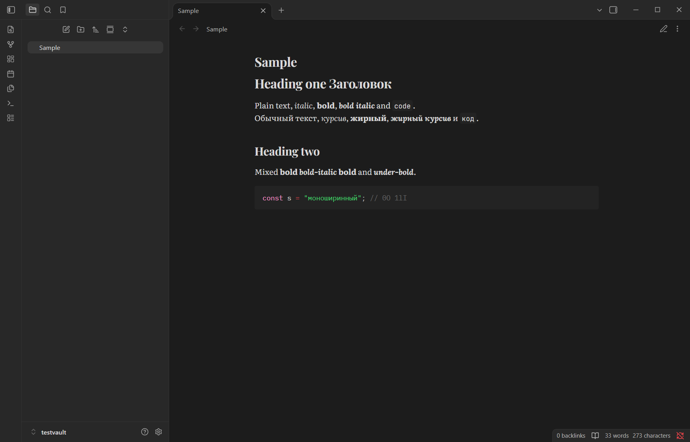
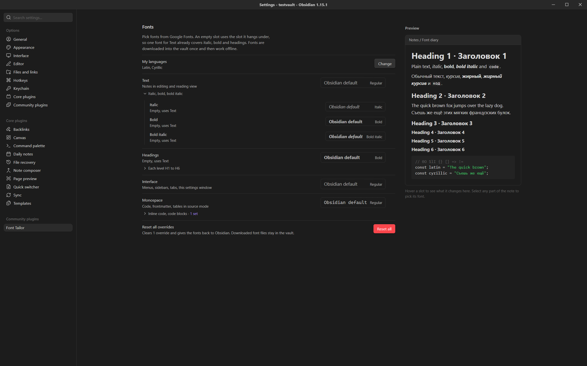
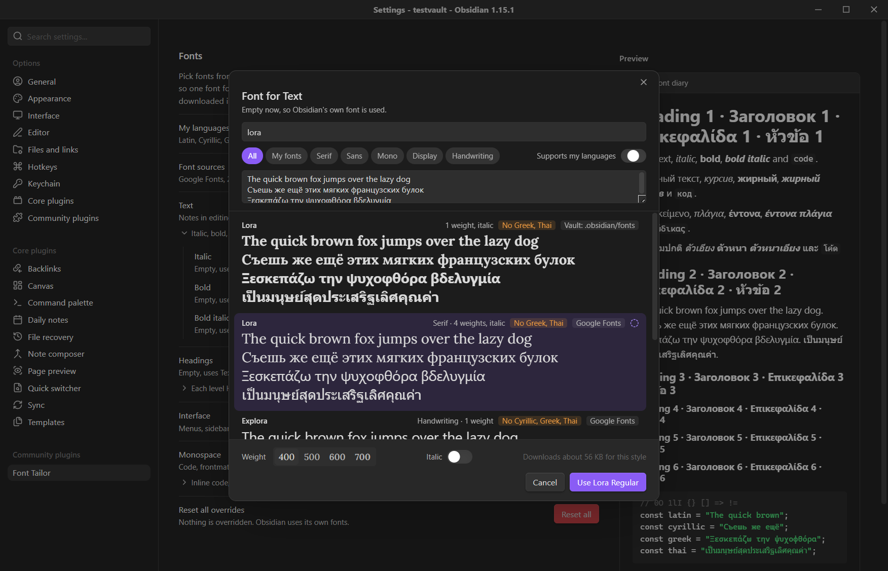
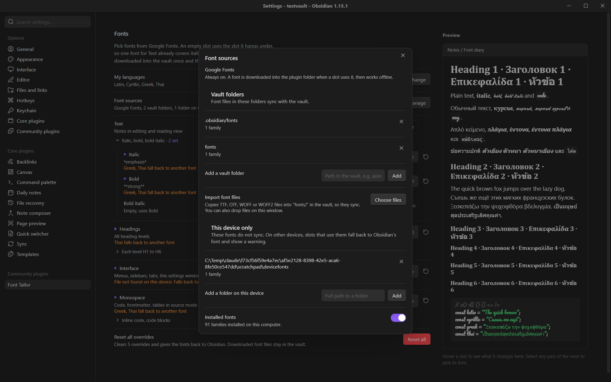

# Font Tailor

Change the fonts Obsidian uses, either broadly or one style at a time. Pick from the free Google Fonts catalog or use your own font files.

## What it does

- **Broad overrides.** Set one font for note text, one for the interface (menus, sidebars, tabs, settings) and one for monospace (code, frontmatter, tables in source mode).
- **Per-style overrides.** Give italic, bold, bold italic, each heading level H1 to H6, inline code and code blocks their own family, weight and italic.
- **Fallback chain.** An empty slot uses the slot it hangs under, so one font for text already covers italic, bold and headings. Bold italic uses Bold if Bold is set, otherwise Italic, otherwise Text. Text, Interface and Monospace use Obsidian's own font when empty.
- **Live preview.** A sample note next to the slots shows every change. Hover a slot to see what it affects, or select part of the note to pick its font.
- **Google Fonts picker.** Search and filter the catalog (serif, sans, mono, display, handwriting), preview each font in your own languages, pick a weight and italic, and see the download size before you apply it.
- **Your languages.** Tell the plugin which scripts you write in (Latin, Cyrillic, Greek, CJK, Thai and others). The picker shows a sample line for each, can hide fonts that miss one, and a slot warns when its font lacks a script.
- **Your own fonts.** Use TTF, OTF, WOFF and WOFF2 files from vault folders, import font files into the vault, and on desktop use folders outside the vault and the fonts installed on your computer.

## How to use

1. Open **Settings → Font Tailor**.
2. Select **Change** next to **My languages** if the defaults (Latin plus the scripts of Obsidian's language and your system languages) are not what you write in.
3. Select the font box of a slot (for example **Text**) to open the picker, choose a font, weight and italic, then select **Use**.
4. To return a slot to its parent, select the reset icon next to it. **Reset all** clears every override.

Removing an override or disabling the plugin gives the fonts back to Obsidian.

## Font sources

All sources share the same picker (filter **My fonts**), slots and fallback chain. Open them with **Settings → Font Tailor → Font sources → Manage**.

- **Google Fonts.** Always on. A font is downloaded when a slot uses it, then works offline.
- **Vault folders.** By default `<config folder>/fonts` (usually `.obsidian/fonts`) and `fonts/`, plus any folders you add. These sync with the vault and work on mobile.
- **Import font files.** Choose or drop TTF, OTF, WOFF or WOFF2 files. They are copied into `fonts/` in the vault, so they sync.
- **Folders on this device** (desktop only). Folders outside the vault.
- **Installed fonts** (desktop only). The fonts installed on the computer.

The plugin reads family, weight, italic and supported scripts from the font's `name`, `OS/2`, `post` and `cmap` tables (TTF, OTF, TTC, WOFF). Obsidian has no Brotli decoder for WOFF2 tables, so for WOFF2 files the family, weight and italic come from the file name (for example `Inter-SemiBoldItalic.woff2`) and the scripts are measured in the browser.

## Desktop only features

The plugin works on mobile, except for two font sources that need file system access only the desktop app has:

- **Folders on this device** read font files from folders outside the vault that you add yourself.
- **Installed fonts** lists the fonts installed on the computer, through the Local Font Access API or, when it is not available, by reading the operating system's font folders (for example `C:\Windows\Fonts` and your user font folder on Windows, `/Library/Fonts` and `~/Library/Fonts` on macOS, `/usr/share/fonts` and `~/.local/share/fonts` on Linux).

These two sources are the only places the plugin reads files outside the vault, and it only reads font files there. Fonts from them do not sync. On another device, a slot that uses one falls back to Obsidian's font and says why.

## Network use

Font Tailor contacts Google Fonts only, and only for the Google Fonts features:

- `https://fonts.google.com/metadata/fonts`: the list of Google Fonts. It is downloaded when you first open the font picker and cached in the plugin folder for 30 days.
- `https://fonts.googleapis.com/css2` and `https://fonts.gstatic.com`: font files. While the picker is open, it loads the fonts you browse for the previews and asks for their file sizes. When you apply a font, the plugin downloads the weights and styles your slots use, in the subsets of your languages, and stores them in the vault.

The requests contain only font family names, weights, styles and subsets. Nothing about your vault or notes is sent. There is no telemetry, no account and no API key. Fonts from vault folders, imported files, device folders and installed fonts never use the network. Once a font is downloaded, it works offline.

## Files written

- `<config folder>/plugins/font-tailor/fonts/`: downloaded Google Fonts files.
- `<config folder>/plugins/font-tailor/catalog.json`: the cached Google Fonts list.
- `<config folder>/plugins/font-tailor/data.json`: settings.
- `fonts/` in the vault root: font files you import.

`<config folder>` is usually `.obsidian`. Downloaded and imported files stay in the vault after you remove an override or disable the plugin; delete them by hand if you no longer need them.

## Manual install

Copy `main.js`, `styles.css` and `manifest.json` from the [latest release](https://github.com/evgvoronov/font-tailor/releases/latest) to `<Vault>/.obsidian/plugins/font-tailor/`, then enable Font Tailor in **Settings → Community plugins**.

## Development

Needs Node.js 18 or newer (tests need 22.6 or newer).

- `npm install` installs dependencies.
- `npm run dev` rebuilds `main.js` from `src/main.ts` on every change.
- `npm run build` type-checks and makes a production build.
- `npm run lint` runs ESLint with the Obsidian rules.
- `npm test` checks the fallback chain and the font file parser (`test/`).

Source map: `slots.ts` (slot tree and fallback chain), `scripts.ts` (writing systems and samples), `catalog.ts` (font list), `fonts.ts` (downloads and font faces), `fontfile.ts` (font table parser), `sources.ts` and `sourcesModal.ts` (local font sources), `apply.ts` (body classes and CSS variables; the selectors are in `styles.css`), `settings.ts`, `picker.ts`, `note.ts` (preview).

## Releasing

Set `minAppVersion` in `manifest.json` if needed, then run `npm version patch` (or `minor`, `major`). It bumps the version in `package.json` and `manifest.json` and adds the entry to `versions.json`. Pushing a tag runs `.github/workflows/release.yml`, which builds and creates a draft GitHub release with `main.js`, `manifest.json` and `styles.css`.

## License

[MIT](LICENSE)
